# Beipackzettel: Live-Quiz

Stand: 24.11.2026 · Adresse: https://quiz.yannikbrand.eu · Für Lehrkräfte und Schüler/innen
(Die Bilder zeigen den Demo-Modus mit erfundenen Spitznamen. Im echten Betrieb sieht es genauso aus.)

**Kurz gesagt:** Du legst einen Raum an, die Klasse tritt mit einem Code oder QR-Code bei, alle beantworten Fragen am Handy, und alle sehen live, wer vorne liegt. Am Ende gibt es eine Siegerehrung. Es werden nur Spitznamen gespeichert, keine echten Namen. Nach 24 Stunden ist alles gelöscht.

---

## Für die Lehrkraft

### 1. Quiz zusammenstellen
Auf der Seite „Neues Quiz“ gibst du einen Titel ein und wählst Fragen aus: aus einem Lernraum-Kurs, eigene Fragen, Datei (CSV/JSON), KI-Anleitung oder ein fertiges Demo-Quiz.

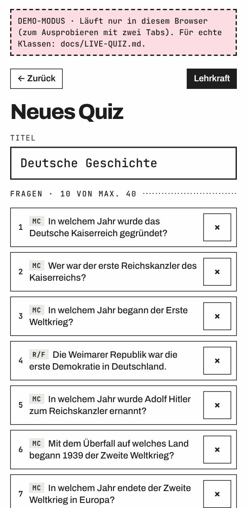

- **Alle Fragen löschen** leert die ganze Liste und den Titel (mit Rückfrage).
- **Spiel ausprobieren (Demo)** zeigt dir das Warte-Spiel, ohne dass ein Raum nötig ist. Es wird nichts gespeichert oder gesendet.
- **Antworten mischen** sorgt dafür, dass die richtige Antwort nicht immer an derselben Stelle steht.

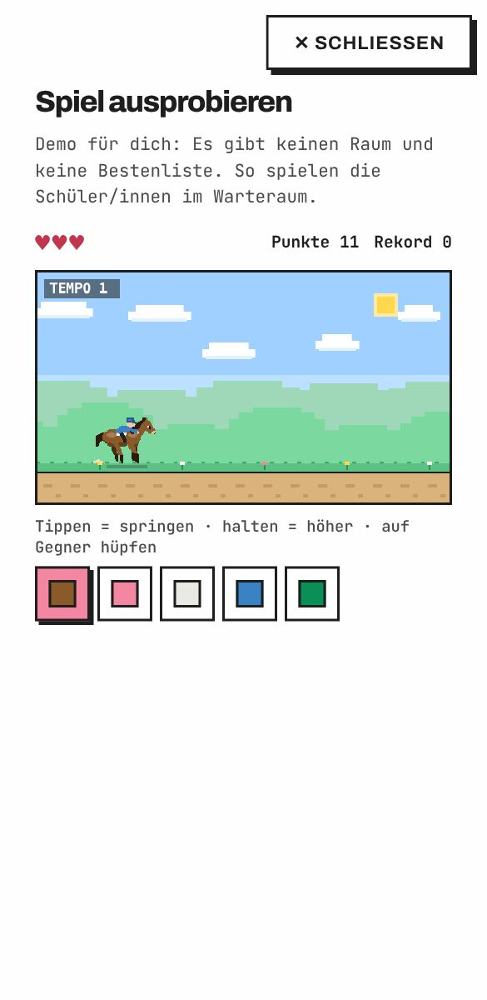

### 2. Raum öffnen und Warteraum
Mit „Raum öffnen“ bekommst du einen 5-stelligen Code und einen QR-Code. Die Klasse tritt bei, spielt im Warteraum das Hürdenritt-Spiel und du siehst, wer da ist.

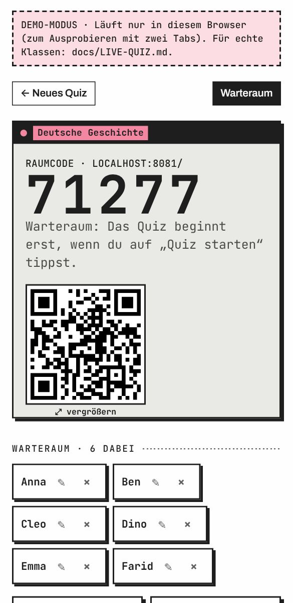

- **QR-Code antippen** zeigt ihn im Vollbild, gut für den Beamer und die hintere Reihe. Tippen oder Esc schließt.

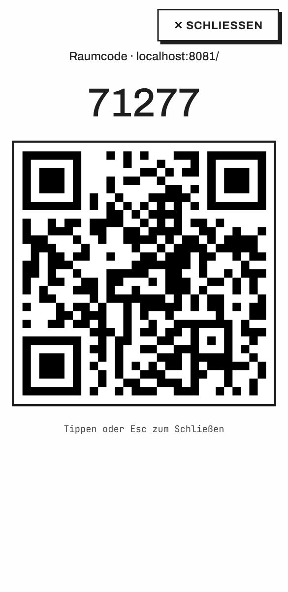

- **Quiz auf Zeit:** Wähle ein Zeitlimit (3, 5, 10, 15, 20 oder 30 Minuten). Die Uhr startet mit „Quiz starten“ und läuft für alle gleich. Danach können keine Antworten mehr abgegeben werden.
- **Aufholbonus:** Wer weit hinten liegt, bekommt für richtige Antworten doppelte Punkte (ab 4 Personen). Siehe „Wie wird gewertet?“ unten.
- **Namen ausblenden** zeigt „SuS 1, 2 …“ statt der Spitznamen (für den Beamer).
- **Musik:** Ruhige Hintergrundmusik, nur auf deinem Gerät, Standard aus.

### 3. Quiz starten und beobachten
„Quiz starten“ schickt alle los (Countdown 3-2-1). Du siehst die Rennbahn: Jede richtige Antwort bringt das Pferd ein Stück näher ans Ziel. Mit **Beamer-Ansicht** wird alles groß und ohne Bedienknöpfe gezeigt.

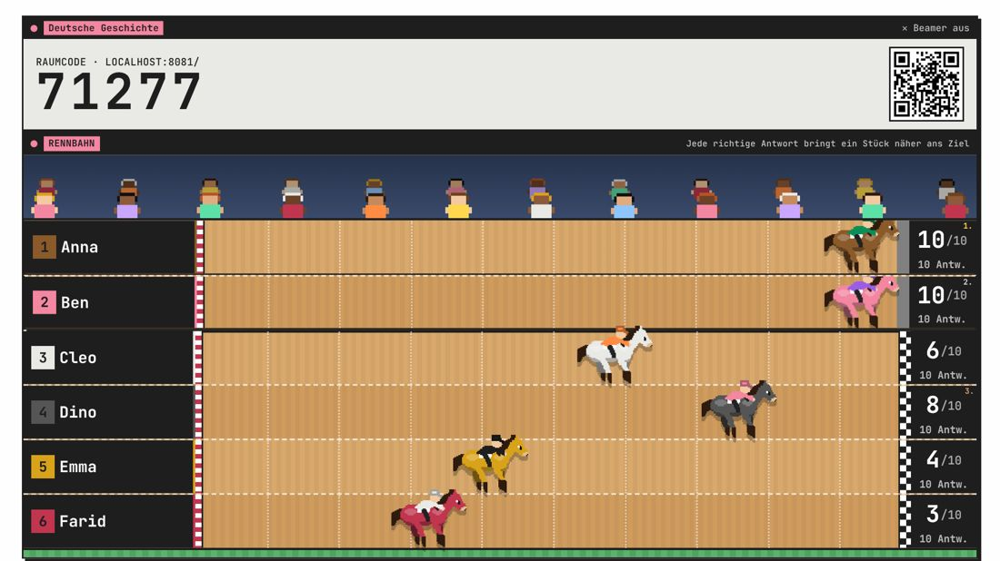

### 4. Siegerehrung
Der Knopf **🏆 Siegerehrung** (wird rosa, sobald alle fertig sind, die Zeit abgelaufen ist oder du beendet hast) startet die Show: Platz 3, Platz 2, dann der Sieger mit Pferd, Krone, Namen und Konfetti. Ohne Ton. Ein Tipp auf den Bildschirm springt zum Ergebnis, „Nochmal abspielen“ wiederholt die Show.

### 5. Beenden und auswerten
„Quiz beenden“ stoppt alles. **Ergebnis exportieren** speichert eine Tabelle (CSV für Excel) mit Platz, Punkten, Bonus, der Zeit bis zur letzten richtigen Antwort und jeder Einzelantwort. „Raum löschen“ entfernt den Raum sofort.

---

## Für Schüler/innen (Handy)

1. Seite öffnen, Code eingeben oder QR-Code scannen, **Spitznamen** wählen (nicht den echten Namen).
2. Im Warteraum das Spiel spielen: Tippen = springen, Halten = höher. Auf Gegner springen gibt +25. Abgründe überspringen, Münzen sammeln.

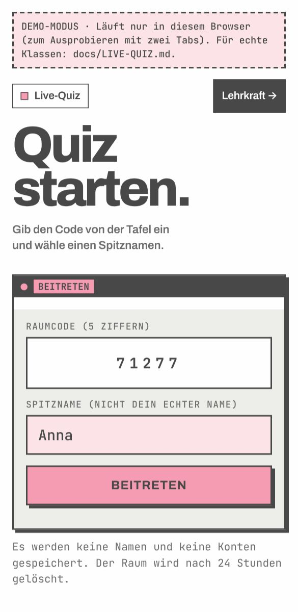 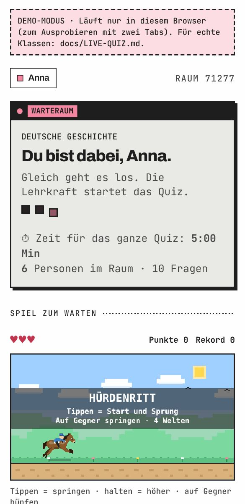

3. Wenn es losgeht, beantwortest du die Fragen. **Oben siehst du immer deinen Platz, deine Punkte und (bei Zeitlimit) die Restzeit.**

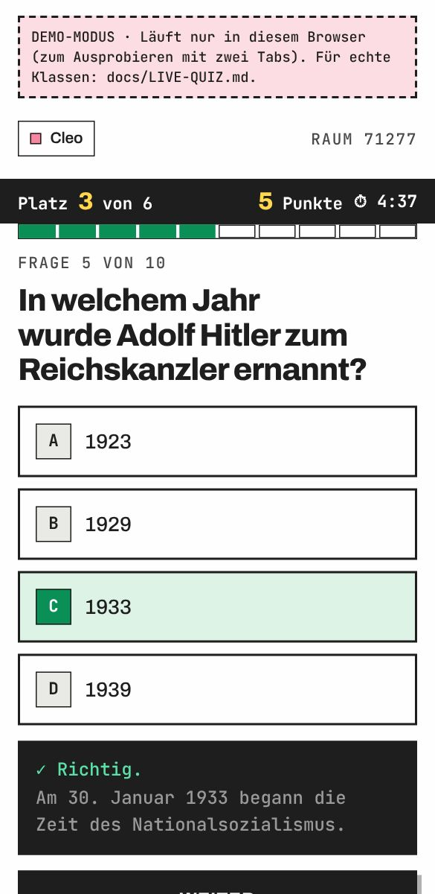

4. Bist du fertig, siehst du das Rennen der anderen live.

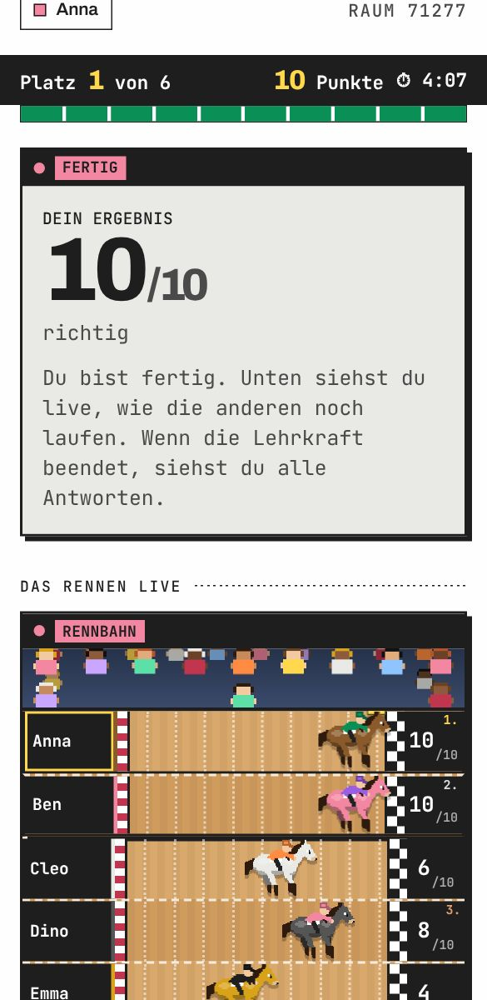

5. Am Ende kommt die Siegerehrung auf dein Handy, danach dein Platz, deine Punkte und der **Lernzettel** mit allem, was du wiederholen solltest. Speichere ihn, der Raum wird nach 24 Stunden gelöscht.

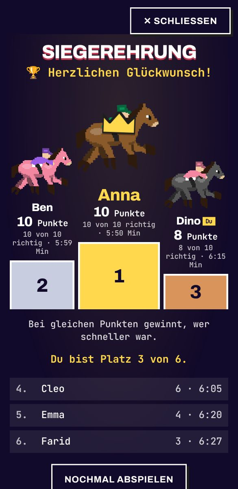 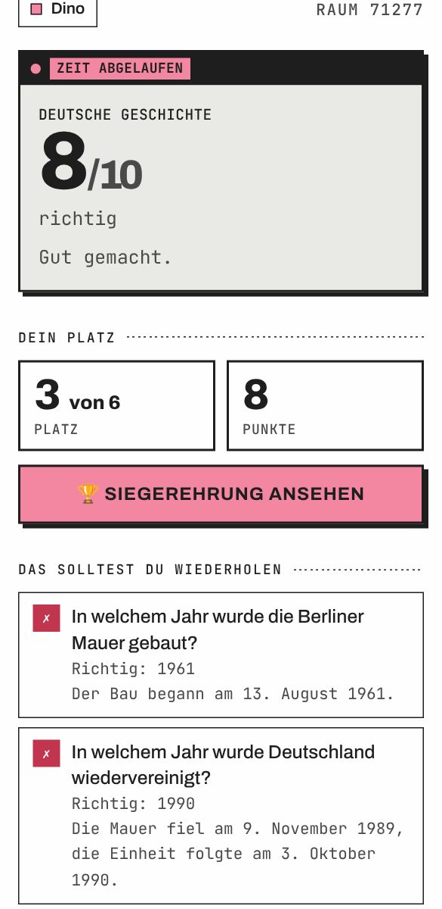

---

## Wie wird gewertet?

- **Punkte = richtige Antworten (+ Bonuspunkte, wenn der Aufholbonus an ist).** Falsche Antworten geben keine Minuspunkte.
- **Gleichstand:** Haben zwei Personen gleich viele Punkte, liegt vorn, wer seine letzte richtige Antwort früher abgegeben hat (gemessen ab Start des Quiz). Bei Gleichstand sieht man die Zeit auch in der Siegerehrung.
- **Warum kann jemand 33 von 30 Punkten haben?** Das kommt vom **Aufholbonus**: Wer weit hinten liegt, bekommt für eine richtige Antwort 2 Punkte statt 1. Mit 30 Fragen und 3 Bonus-Antworten sind das 33 Punkte. Das war früher in der Rennbahn missverständlich („33/30“). Jetzt steht bei eingeschaltetem Bonus „Pkt“ statt „/30“, und auf dem Handy steht „30 richtig + 3 Bonuspunkte = 33 Punkte“. Wer das nicht möchte, schaltet den Aufholbonus aus.

## Häufige Fragen

- **Kann ich nach Ablauf der Zeit noch antworten?** Nein. Die Antwort wird abgelehnt, das Handy zeigt das Ende mit Platz und Punkten.
- **Ein Schüler hat die Seite zugemacht.** Einfach wieder öffnen, die Antworten sind gespeichert (auf demselben Handy).
- **Kein Ton?** Stimmt. Das Spiel und die Siegerehrung sind absichtlich stumm. Nur die Lehrkraft kann Hintergrundmusik zuschalten.
- **Datenschutz:** Nur Spitznamen, keine Konten, nach 24 Stunden gelöscht.

## Für die Technik (Wartung)

- **Neu in dieser Version: SQL muss einmal ausgeführt werden.** Die ganze Datei `supabase/quiz.sql` im Supabase-SQL-Editor ausführen (sie ist wiederholbar). Sie ergänzt Zeitlimit (`time_limit`, `started_at`, `quiz_set_time`) und die Schnelligkeit (`lt`) in den Abfragen. Ohne dieses SQL laufen Quiz und Spiel weiter, nur das Zeitlimit und die Schnelligkeit bei Gleichstand fehlen.
- Dateien: `quiz.js` (Ansichten, Demo-Backend), `race.js` (Rennbahn), `ceremony.js` (Siegerehrung), `game.js` (Spiel), `quiz.css`.
- Neue Screenshots für dieses Dokument entstehen mit Playwright im Demo-Modus (siehe `docs/LIVE-QUIZ.md`).

> **Projektregel:** Zu jeder Änderung am Live-Quiz gehört, dass dieser Beipackzettel mit aktuellen Screenshots mitgepflegt wird.
